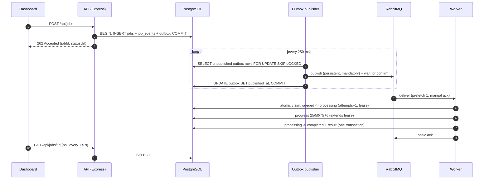

# Architecture Audit

This document explains the design decisions in this project and the guarantees they provide. It also names the guarantees the project does **not** provide. Each claim points to the code and the QA test that exercises it.

> Status: written as part of the AI-generated initial draft. The student must review each section against the code and record any disagreement in [AI_AUDIT_LOG.md](AI_AUDIT_LOG.md).

---

## 1. Component overview



| Component | Code | Responsibility |
|---|---|---|
| Producer (API) | `api/src/routes/jobs.js`, `api/src/jobsRepository.js` | Validate, persist job + outbox atomically, return 202 |
| Outbox publisher | `worker/src/outbox-publisher.js` | Move outbox rows to RabbitMQ with publisher confirms |
| Broker | `docker-compose.yml` (`rabbitmq`), `worker/src/rabbit.js` (topology) | Durable buffering, delivery, retry delay, dead-lettering |
| Worker | `worker/src/index.js`, `worker/src/handler.js` | Consume, claim, process, commit, ACK |
| Status store | `database/migrations/001_initial_schema.sql` | Source of truth for job state, idempotency, audit trail |

## 2. Why this is a real asynchronous messaging system (not an in-memory queue)

- Work crosses **process and container boundaries**. The API and the worker are separate containers built from separate `package.json` files, and they share no memory. The only paths between them are PostgreSQL and a real AMQP 0-9-1 broker (RabbitMQ 4.1).
- Messages are stored **durably by the broker**: durable queues, `deliveryMode = 2` persistent messages, and a named Docker volume at `/var/lib/rabbitmq`. Pending work survives a broker restart. *QA TEST 6* restarts RabbitMQ with 3 ready messages and checks that they are still there.
- Delivery uses **broker-managed acknowledgements**: if a consumer dies, RabbitMQ redelivers its unacknowledged messages. An in-memory queue would lose them. *QA TEST 3* kills the worker with SIGKILL mid-job.
- Consumers can **scale horizontally** (`docker compose up -d --scale worker=3`). RabbitMQ distributes messages across them, and PostgreSQL row locking prevents double processing.

## 3. Why HTTP 202 Accepted is returned before processing completes

Report generation takes 3–5 s. If the API waited for it:
- every HTTP request would hold a connection and a Node.js request slot for the whole job, so throughput would collapse under bursts;
- a client timeout or worker crash would leave the client unsure whether the work happened;
- the API's availability would depend on the worker's availability.

`202 Accepted` (RFC 9110 §15.3.3) means *"the request has been accepted for processing, but the processing has not been completed"*. The response includes the `jobId`, a `statusUrl` and a `Location` header. The client then polls `GET /api/jobs/:id`.

The API's only synchronous dependency is one short PostgreSQL transaction, so the measured latency is in the low milliseconds. *QA TEST 1* measures p50/p95 over 10 requests and compares p95 with `QA_LATENCY_BUDGET_MS` (default 100 ms). This is a measurement on the student's machine, not a guarantee.

## 4. Durable queues and persistent messages

Durability needs all three of the following. Missing any one of them loses messages on a broker restart:

| Setting | Where | Effect |
|---|---|---|
| `durable: true` on exchanges and queues | `worker/src/rabbit.js#assertTopology` | The queue *definition* survives a restart |
| `persistent: true` (`deliveryMode 2`) | outbox publisher, retry and DLQ publishes | The *message* is written to disk |
| Named volume + fixed `hostname: rabbitmq` | `docker-compose.yml` | The data directory survives container re-creation. RabbitMQ keys its data by node name (`rabbit@<hostname>`), so a changing hostname would start an empty node |

**Limitation.** Classic queues on a single node are not replicated. If the disk is lost, the messages are lost. Production systems use quorum queues on a 3-node cluster. A broker volume wipe is the reason the **reconciler** exists (see §8).

## 5. Explicit ACK/NACK handling

The worker consumes with `noAck: false` and `prefetch = WORKER_PREFETCH` (default 1).

| Situation | Action | Why |
|---|---|---|
| Job completed and committed | `ack` **after** `COMMIT` | If the worker dies before the ACK, the message is redelivered and the duplicate is detected (§7). Acking before the commit could lose the job |
| Simulated/application failure, attempts left | DB: `processing → queued` + error, then publish to the retry exchange (confirmed), then `ack` | Delayed retry, no hot loop (§9) |
| Failure on the last attempt, or a non-retryable error | DB: `processing → failed`, then publish to the DLX (confirmed), then `ack` | Terminal state recorded before the message leaves the main queue |
| Poison message (bad JSON, unknown job) | publish to the DLX, then `ack` | Retrying can never succeed |
| **Infrastructure error** (PostgreSQL unreachable, connection reset) | wait `INFRA_RETRY_BACKOFF_MS`, then `nack(requeue = true)` | It is not the job's fault, so no attempt is consumed. The back-off prevents a tight requeue loop |
| Duplicate of a completed or failed job | `ack`, record `duplicate_ignored` | Idempotency |

**Prefetch = 1** means RabbitMQ never sends this consumer a second message until the first one is acked. With a single worker this produces the strictly sequential processing that *QA TEST 2* checks by looking for overlapping `claimed..completed` windows in `job_events`.

The main queue also declares `x-dead-letter-exchange = reports.dlx`. Any `nack(requeue = false)` or `reject` is therefore routed to the DLQ by the broker itself. The worker additionally publishes to the DLX explicitly, so it can attach diagnostic headers (`x-dead-letter-reason`, `x-error-message`, `x-failed-attempt`, ...).

## 6. Worker crash recovery

1. A worker is processing job A. RabbitMQ shows A's message as *unacked* on that worker's channel. PostgreSQL shows `status = processing`, `locked_by = <worker instance>` and `lease_expires_at = now + JOB_LEASE_MS`.
2. The worker is SIGKILLed. Its TCP connection closes (or, after a network partition, the AMQP heartbeat times out). RabbitMQ returns every unacked message of that connection to the queue as `redelivered = true`.
3. The job row still says `processing` and is **not** marked completed. The ACK-after-commit rule guarantees this.
4. A new worker process starts (Docker restart policy or `docker compose start worker`) with a **new** `workerId`. When it receives A:
   - if the dead worker's lease has **not** expired yet, the claim updates 0 rows. The worker *defers* the message through the retry queue (`deferred` event) and ACKs it;
   - once the lease has expired, the claim succeeds (`attempts` becomes 2) and A is processed normally.
5. A completes exactly once. *QA TEST 3* checks the event sequence `claimed (worker 1) → deferred → claimed (worker 2) → completed`, and that the main queue is empty at the end.

The lease is refreshed at every progress update (about every 1 s), so a long but healthy job never loses its lease. A crashed worker's lease expires `JOB_LEASE_MS` (10 s) after its last heartbeat.

**Interrupted attempts count.** Every claim increments `attempts`. A message that crashes the worker every time (a "crash-poison" job) is therefore bounded too: on the claim where `attempts > MAX_ATTEMPTS`, the job is marked `failed` (`category: attempts_exhausted`) and dead-lettered.

**Graceful shutdown** (`docker compose stop worker` sends SIGTERM) cancels the consumer so no new deliveries arrive, then waits up to `WORKER_SHUTDOWN_TIMEOUT_MS` for in-flight jobs before closing. The Compose `stop_grace_period` (20 s) is longer than that timeout.

## 7. Idempotency: how duplicates are identified and neutralised

RabbitMQ (like any broker without distributed transactions) provides **at-least-once** delivery. Duplicates arise from:
- the outbox publisher crashing after the broker confirmed a message but before `published_at` was committed (the same `message_id` is published again);
- a worker dying after `COMMIT` but before `ack` (redelivery);
- the reconciler re-enqueuing a stale job (a new `message_id`);
- deliberate redelivery in *QA TEST 4*.

**Identification.** The idempotency key is the **job ID** carried in every message, not the message ID. The authoritative question is "what state is this job in?", and PostgreSQL answers it:

| Job state at claim time | Meaning | Worker action |
|---|---|---|
| `queued` | first delivery or a scheduled retry | claim and process |
| `processing`, lease expired or owned by this process | the previous attempt was interrupted | take over (attempt + 1) |
| `processing`, live lease held by someone else | concurrent duplicate | defer through the retry queue |
| `completed` / `failed` | duplicate of finished work | ACK, record `duplicate_ignored`, **no side effects** |
| row missing | foreign/corrupt message | DLQ (`unknown_job`) |

**Atomicity.** The claim is a single conditional `UPDATE ... WHERE id = $1 AND (status = 'queued' OR <expired lease>) RETURNING *`. Under PostgreSQL's row locking, if two transactions race, the second one re-evaluates the `WHERE` clause after the first commits and updates 0 rows. *QA TEST 4* fires 10 concurrent claims at one job and expects exactly 1 winner.

Every later transition (`progress`, `completed`, `failed`, back to `queued`) also requires `locked_by = <this worker>`, so a worker that lost its lease cannot overwrite the new owner's outcome.

**Defence in depth.** Partial unique indexes allow at most one `completed` event and one `failed` event per job (`job_events_single_completion_idx`). Check constraints keep timestamps consistent with the status (a `completed` job must have `completed_at`, and only a `processing` job may hold a lease).

**Side-effect caveat.** The "side effect" here (writing the result) happens inside the same PostgreSQL transaction as the status change, so it is exactly-once in effect. A real report generator that, say, emailed a PDF would need its own idempotency key (for example, the job ID passed to the email provider). Otherwise a crash between sending and committing could send twice.

## 8. Transactional outbox: solving the dual-write problem

**Problem.** Writing to PostgreSQL and publishing to RabbitMQ are two separate systems with no shared transaction. Either order can fail between the two steps:
- *commit, then publish*: the publish fails, and the job is stuck in `queued` forever;
- *publish, then commit*: the commit fails, and the worker receives a message for a job that does not exist.

**Solution.** The API writes the job **and** the message (an `outbox` row) in one local ACID transaction (`jobsRepository.createJob`). The API never talks to RabbitMQ at all.

A separate **outbox publisher** loop then runs:

```
BEGIN
  SELECT … FROM outbox WHERE published_at IS NULL ORDER BY id LIMIT 50 FOR UPDATE SKIP LOCKED
  publish each (persistent, mandatory, message_id = outbox.message_id)
  waitForConfirms()          -- broker has taken responsibility
  UPDATE outbox SET published_at = now() …
COMMIT
```

| Failure | Outcome |
|---|---|
| Broker down | Publish or confirm fails, `ROLLBACK`, the row stays unpublished, the publisher exits and Docker restarts it, then it retries. Ingestion keeps working (*QA TEST 7*: POST returns 202 while RabbitMQ is stopped, and `/api/health` shows the outbox backlog) |
| Publisher crashes after the confirm, before `COMMIT` | The row is published again later: a duplicate, neutralised by §7 |
| Two publisher replicas | `FOR UPDATE SKIP LOCKED` gives each one disjoint rows |
| PostgreSQL down | The API returns 503 (nothing was accepted, so nothing is lost). The publisher backs off |

**Publisher confirms and their limitations.**
- A confirm (`basic.ack`) means the broker accepted responsibility. For a persistent message on a durable queue, that means it was written to disk. It does **not** mean that a consumer received or processed the message.
- An **unroutable** message (no matching binding) is *also* confirmed. The publisher therefore sets `mandatory: true` and listens for `basic.return`. Returned messages are not marked as published, and their `last_error` is recorded.
- A `basic.nack` (internal broker error) rejects `waitForConfirms()`, and the batch is rolled back and retried.
- Confirms are per channel. If the channel or connection closes before a confirm arrives, the outcome is *unknown*. Treating it as failed (and re-publishing) is what makes the system at-least-once rather than at-most-once.
- On a single node, a confirmed message can still be lost if the disk itself is lost. Quorum queues with replication would address that.

**Reconciler.** Every `RECONCILE_INTERVAL_MS`, the publisher looks for jobs stuck in `queued` or `processing` (expired lease) for more than `RECONCILE_STALE_MS` (10 minutes by default) with no unpublished outbox row, and inserts a fresh outbox row for each. This recovers from messages lost outside the protocol, for example if someone purges a queue or wipes the broker volume. Any duplicates it creates are harmless (§7).

## 9. Bounded retries and DLQ routing

```
reports (direct) ──report.generate──► reports.jobs ──► worker
     ▲                                     │ x-dead-letter-exchange = reports.dlx
     │ TTL expiry (dead-letter back)       ▼
reports.jobs.retry ◄── reports.retry   reports.dlx ──report.dead──► reports.jobs.dlq
 x-message-ttl = RETRY_DELAY_MS
 (no consumers)
```

- **Retry path.** On a retryable failure, the worker records the error, sets the job back to `queued`, publishes a copy to `reports.retry` and ACKs the original. The copy waits `RETRY_DELAY_MS` (3 s) in a queue with no consumers. When it expires, it is dead-lettered back to `reports`. Nothing is redelivered immediately, so there is no hot requeue loop. *QA TEST 5* measures the gap between `retry_scheduled` and the next `claimed` and checks that it is at least `RETRY_DELAY_MS`.
- **Bound.** `MAX_ATTEMPTS` (default 3) total attempts, counted in PostgreSQL (`jobs.attempts`), not in a message header. A lost or forged header therefore cannot reset the counter.
- **DLQ.** After the last attempt, the job is marked `failed`, and the message is published to `reports.dlx` with reason headers and ends up in `reports.jobs.dlq`. That queue is durable, has no consumer, and is inspected manually in the Management UI.
- **Poison messages** (invalid JSON, wrong schema version, non-UUID or unknown job ID) skip the retries and go straight to the DLQ.
- **Simulated vs. real failures.** Simulated failures are `SimulatedFailureError` instances with `simulated: true`, stored as `error_details.category = 'simulated_failure'`. Infrastructure errors are detected by `isInfrastructureError()` (PostgreSQL SQLSTATE classes `08`/`57P0x`, socket error codes, closed AMQP channels). They are handled by NACK + requeue and never consume an attempt.
- **Design trade-off.** A single fixed-TTL retry queue gives a constant delay. Exponential back-off would need one queue per delay level, because RabbitMQ only expires messages from the head of a queue. Per-message TTLs in one queue would block behind longer ones. A constant delay keeps the topology simple for this assignment.

**Operational note.** `x-message-ttl` is fixed when the queue is created. After you change `RETRY_DELAY_MS`, delete `reports.jobs.retry` (it is normally empty) so it can be re-declared. Otherwise RabbitMQ raises `PRECONDITION_FAILED` and the worker restarts in a loop.

## 10. At-least-once delivery: trade-offs

| Semantics | How it would look | Why not chosen |
|---|---|---|
| At-most-once | auto-ack, or ack before processing | Any crash loses jobs |
| **At-least-once (chosen)** | ack after commit, republish on doubt | Duplicates possible, so consumers must be idempotent (§7) |
| Exactly-once | distributed transactions or 2PC between broker and DB | Not offered by RabbitMQ. In practice it is emulated as *at-least-once delivery + idempotent processing*, which is what this project does |

The costs of at-least-once: duplicates, extra database reads on every delivery, a lease protocol, and the need to reason about every crash point. These costs are paid deliberately, because losing a job silently is worse.

**Ordering.** Ordering is not guaranteed. Retries, deferrals and multiple workers reorder jobs, and the design does not depend on order.

## 11. Eventual consistency and operational complexity

- **Eventual consistency.** After the 202, the job's observable state lags reality. It shows `queued` while the message is in the outbox or the broker, and `processing` while a crashed worker's lease is still running out. Clients must poll (the dashboard polls every 1.5 s) and accept that state changes later. `GET /api/jobs/:id` always reads committed PostgreSQL state, so it never reports something that has not durably happened.
- **More moving parts.** The system has five long-running containers plus a migration job, three exchanges and three queues, a lease protocol and a reconciler. Each one is a failure mode to monitor. Things to watch in a real deployment:
  - outbox backlog age (`/api/health` → `degraded`)
  - main queue depth and consumer count
  - DLQ depth (should be 0, so alert on any message)
  - jobs stuck in `processing`
  - worker restart counts
- **Debuggability.** Structured JSON logs carry `jobId` and `messageId`, and `job_events` holds a complete audit trail (`GET /api/jobs/:id/events`).
- **Configuration coupling.** Queue arguments (TTL, DLX) are immutable once a queue is declared. Changing them requires a migration step for the broker as well as the database.
- **Not covered:**
  - authentication and authorisation on the API
  - TLS between services
  - rate limiting
  - multi-node RabbitMQ and PostgreSQL high availability
  - retention and cleanup of old jobs, events and outbox rows (tables grow without bound)
  - metrics export (Prometheus)

  These are out of scope for a local college assignment and are listed so they are not mistaken for oversights.

## 12. Requirement traceability

| Requirement | Implementation | Verified by |
|---|---|---|
| 202 + UUID, no waiting | `routes/jobs.js` | Unit `api/tests/app.test.js`; QA TEST 1 |
| Schema validation | `api/src/validation.js` (zod, `.strict()`) | Unit `validation.test.js`; QA TEST 7 |
| Outbox + confirms | `jobsRepository.createJob`, `outbox-publisher.js` | QA TEST 6, TEST 7 (broker down) |
| Durable/persistent | `rabbit.js`, compose volume + hostname | QA TEST 6 |
| Manual ACK after commit | `handler.js` | Unit `handler.test.js` (call order); QA TEST 3 |
| Prefetch 1, sequential | `index.js` `prefetch()` | QA TEST 2 |
| Bounded retry + delay | `handler.js`, retry queue TTL | Unit `handler.test.js`; QA TEST 5 |
| DLQ + poison | `handler.js`, DLX topology | QA TEST 5 |
| Crash recovery | broker redelivery + lease | QA TEST 3 |
| Idempotency / atomic claim | `jobRepository.claimJob`, unique indexes | QA TEST 4 |
| Graceful shutdown | `index.js#shutdown` | Manual check (README › "Stop and restart the worker") |
| DB / broker failures | `app.js` error handler, outbox | Unit `app.test.js`; QA TEST 7 |
| No secrets exposed | env-only config, `.gitignore`, generic errors | QA TEST 7 |
