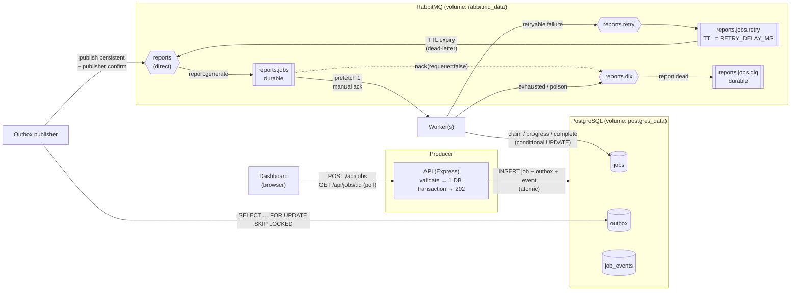
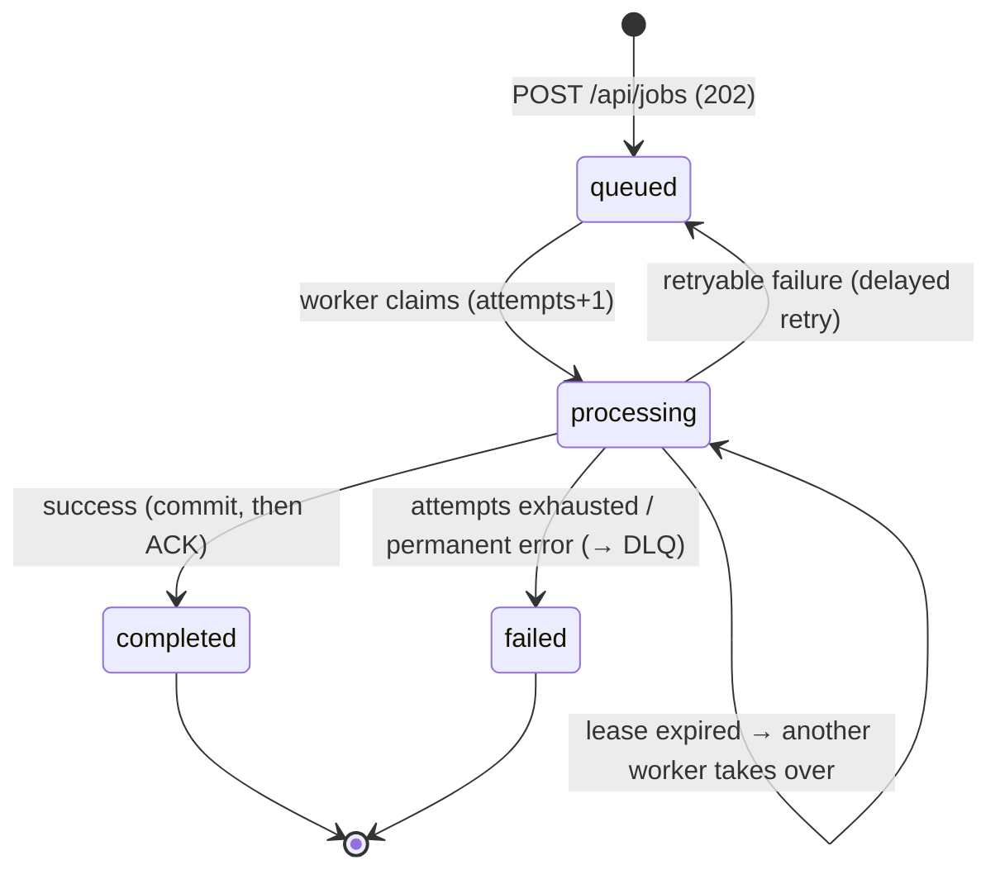

# Async-Messaging-Architecture

An asynchronous report-generation system. A REST API accepts requests and answers **HTTP 202 Accepted** within milliseconds. **RabbitMQ** buffers the work and distributes it to background **workers**. **PostgreSQL** is the durable source of truth for job status, idempotency and the transactional outbox.

Built for a Week 06 assignment on asynchronous messaging, event-driven systems, message brokers, worker resilience and distributed-system reliability.

> **AI disclosure.** The initial implementation and documentation were generated by **Claude** (Anthropic), using Claude Code. The student is responsible for reviewing, running, testing and verifying everything in this repository.
> - [AI_PROMPTS.md](AI_PROMPTS.md): the exact prompts used
> - [AI_AUDIT_LOG.md](AI_AUDIT_LOG.md): what the AI did and did not execute, the review checklist, and the student's defects and corrections
> - [ARCHITECTURE_AUDIT.md](ARCHITECTURE_AUDIT.md): design rationale and guarantees
> - [QA_TEST_RESULTS.md](QA_TEST_RESULTS.md): the test record, to be filled in by the student with their own results

---

## Contents

1. [Features](#features)
2. [Technology stack](#technology-stack)
3. [Architecture](#architecture)
4. [Directory structure](#directory-structure)
5. [Prerequisites](#prerequisites)
6. [Setup and startup](#setup-and-startup)
7. [Using the API (curl)](#using-the-api-curl)
8. [RabbitMQ Management UI](#rabbitmq-management-ui)
9. [Inspecting queues, logs and the database](#inspecting-queues-logs-and-the-database)
10. [Stop and restart the worker](#stop-and-restart-the-worker)
11. [Running the tests](#running-the-tests)
12. [How reliability works](#how-reliability-works)
13. [Configuration](#configuration)
14. [Stop, reset and clean up](#stop-reset-and-clean-up)
15. [Troubleshooting](#troubleshooting)

## Features

- `POST /api/jobs` validates the request with **zod**, stores the job and its outbox message in **one transaction**, and returns `202` with a status URL.
- A **transactional outbox** plus a publisher using **RabbitMQ publisher confirms**: no job is lost if the broker is down.
- **Durable** queues, **persistent** messages, a **manual ACK** only after the database commit, and configurable **prefetch** (default 1).
- **Bounded retries** through a TTL delay queue (no hot requeue loop), and a durable **dead-letter queue** for exhausted and poison messages.
- **Crash recovery**: unacked messages are redelivered, and processing leases let another worker take over safely.
- **PostgreSQL idempotency**: atomic conditional state transitions, plus a unique index that allows at most one completion per job.
- A dashboard in plain HTML/CSS/JS with live polling, status badges, durations, error display and a 5-job burst button.
- **Unit tests** (Jest + Supertest) and an **end-to-end QA suite** (7 scenarios) that kills, stops and restarts real containers.

## Technology stack

| Layer | Technology |
|---|---|
| API / producer | Node.js 24, Express 4, zod, helmet, node-postgres |
| Broker | RabbitMQ 4.1 with the management plugin (AMQP 0-9-1) |
| Worker / outbox publisher | Node.js 24, amqplib, node-postgres |
| Status store | PostgreSQL 16 |
| Frontend | HTML, CSS and vanilla JavaScript (served by the API) |
| Orchestration | Docker Compose |
| Tests | Jest 29, Supertest, amqplib, pg |
| CI (optional) | GitHub Actions (`.github/workflows/ci.yml`) |

## Architecture



### The four roles

| Role | Service | What it does |
|---|---|---|
| **Producer** | `api` | Validates input and generates a UUID. In one PostgreSQL transaction it inserts the `jobs` row, a `created` audit event and an `outbox` row, then answers `202 Accepted`. It never waits for processing and never talks to RabbitMQ directly. |
| **Relay** | `outbox-publisher` | Polls unpublished outbox rows, publishes them as persistent messages with `mandatory: true`, waits for broker **confirms**, then marks them published. It also re-enqueues jobs that have been stuck for a very long time (the reconciler). |
| **Broker** | `rabbitmq` | Durable topology: main queue, delay/retry queue and dead-letter queue. Buffers bursts, redelivers unacked messages and routes dead letters. |
| **Consumer** | `worker` | Consumes with manual ACK. It atomically claims the job (`queued → processing`, `attempts + 1`, lease), simulates 3–5 s of work, writes progress, commits `completed` with the result, and only then ACKs. Failures are retried with a delay or dead-lettered. |
| **Status store** | `postgres` | `jobs` (state machine with check constraints), `outbox`, and `job_events` (audit trail with one-completion-per-job unique indexes). |

Job state machine:



## Directory structure

```
Async-Messaging-Architecture/
├── api/                          # REST API producer (+ migration runner)
│   ├── Dockerfile
│   ├── package.json / package-lock.json
│   ├── src/
│   │   ├── app.js                # Express app factory, error handling, /api/health, /api/stats
│   │   ├── config.js             # env-based configuration
│   │   ├── db.js                 # pg Pool + "database unavailable" detection
│   │   ├── healthcheck.js        # Docker HEALTHCHECK script
│   │   ├── jobsRepository.js     # transactional outbox insert, queries
│   │   ├── logger.js             # JSON-lines logger
│   │   ├── migrate.js            # SQL migration runner (advisory lock + checksums)
│   │   ├── routes/jobs.js        # POST/GET /api/jobs, GET /api/jobs/:id(/events)
│   │   ├── serializers.js        # DB row → JSON (durations)
│   │   ├── server.js             # entry point, graceful shutdown
│   │   └── validation.js         # zod schemas
│   └── tests/                    # unit tests (no Docker needed)
├── worker/                       # RabbitMQ consumer + outbox publisher
│   ├── Dockerfile
│   ├── package.json / package-lock.json
│   ├── src/
│   │   ├── config.js
│   │   ├── db.js
│   │   ├── errors.js             # error taxonomy & infrastructure detection
│   │   ├── handler.js            # ACK/NACK/retry/DLQ state machine
│   │   ├── healthcheck.js        # heartbeat-file HEALTHCHECK
│   │   ├── heartbeat.js
│   │   ├── index.js              # worker entry point (consumer)
│   │   ├── jobRepository.js      # atomic claim / progress / complete / fail
│   │   ├── logger.js
│   │   ├── messages.js           # message parsing & poison detection
│   │   ├── outbox-publisher.js   # outbox relay with publisher confirms + reconciler
│   │   ├── rabbit.js             # connection, topology, confirmed publish
│   │   └── reportGenerator.js    # simulated 3–5 s report + failure simulation
│   └── tests/                    # unit tests
├── frontend/                     # dashboard (served by the API)
│   ├── index.html
│   ├── styles.css
│   └── app.js
├── database/
│   └── migrations/001_initial_schema.sql
├── tests/                        # end-to-end QA suite (needs the running stack)
│   ├── package.json / package-lock.json
│   ├── sequencer.js              # runs files in 01→07 order
│   ├── helpers/                  # api, compose, db, rabbit, env, wait
│   └── integration/01-…07-*.test.js
├── scripts/                      # bash helpers (burst, inspect queues, db status, reset)
├── .github/workflows/ci.yml      # unit + integration tests on GitHub Actions
├── docker-compose.yml
├── .env.example
├── .gitignore / .dockerignore
├── README.md
├── ARCHITECTURE_AUDIT.md
├── AI_AUDIT_LOG.md
├── AI_PROMPTS.md
└── QA_TEST_RESULTS.md
```

## Prerequisites

- **Docker Desktop** (Windows/macOS) or Docker Engine with the Compose v2 plugin (Linux). Check with `docker compose version`.
- **Node.js 20 or newer** (only needed to run the tests from your machine). Check with `node -v`.
- **Git**.
- Free local ports: `3000` (API/dashboard), `5433` (PostgreSQL), `5672` and `15672` (RabbitMQ). All of them can be changed in `.env`.

## Setup and startup

```bash
git clone <your-repo-url> Async-Messaging-Architecture
```

```bash
cd Async-Messaging-Architecture
```

Create your local environment file and **change the two passwords** in it:

```bash
cp .env.example .env
```

(Windows PowerShell: `Copy-Item .env.example .env`)

Build and start everything:

```bash
docker compose up --build -d
```

Check status. Wait until all services show `healthy`; `migrate` should show `Exited (0)`:

```bash
docker compose ps
```

- **Dashboard:** http://localhost:3000
- **API health:** http://localhost:3000/api/health
- **RabbitMQ Management UI:** http://localhost:15672

Startup order is enforced with health checks: `postgres` → `migrate` (one-shot schema migration) → `api`. `rabbitmq` must also be healthy before `outbox-publisher` and `worker` start.

## Using the API (curl)

The examples use bash/zsh (macOS, Linux, Git Bash, WSL). In Windows PowerShell, call `curl.exe` and wrap the JSON in single quotes, or use the dashboard.

### Submit a job

```bash
curl -i -X POST http://localhost:3000/api/jobs \
  -H "Content-Type: application/json" \
  -d '{"reportType":"sales_summary","parameters":{"startDate":"2026-01-01","endDate":"2026-01-31","format":"pdf"},"requestedBy":"me@example.edu"}'
```

Expected response (the IDs and timings will differ):

```http
HTTP/1.1 202 Accepted
Location: /api/jobs/6f1c0f9e-2b7a-4f7e-9c51-3f0b7d2a9e11
Server-Timing: app;dur=4.21
Content-Type: application/json; charset=utf-8

{"jobId":"6f1c0f9e-2b7a-4f7e-9c51-3f0b7d2a9e11","status":"queued","statusUrl":"/api/jobs/6f1c0f9e-2b7a-4f7e-9c51-3f0b7d2a9e11","submittedAt":"2026-11-23T10:00:00.000Z","message":"Job accepted for asynchronous processing. Poll statusUrl for progress."}
```

**Request body:**

| Field | Required | Values |
|---|---|---|
| `reportType` | yes | `sales_summary`, `inventory_snapshot`, `user_activity`, `financial_statement` |
| `parameters.startDate`, `parameters.endDate` | yes | `YYYY-MM-DD`, start ≤ end, range ≤ 366 days |
| `parameters.format` | no | `pdf` (default), `csv`, `xlsx` |
| `parameters.includeCharts` | no | boolean |
| `requestedBy` | no | string, 1–100 characters |
| `simulate` | no (demo) | `{"mode":"fail_then_succeed","failAttempts":1}` or `{"mode":"always_fail"}`. Only accepted when `ALLOW_FAILURE_SIMULATION=true` |

Unknown fields are rejected.

**Error responses:**

| Status | When | Example body |
|---|---|---|
| `400` | invalid JSON, validation failure, non-UUID id | `{"error":"validation_error","message":"Request validation failed","details":[{"field":"reportType","message":"is required"}]}` |
| `404` | unknown job ID | `{"error":"not_found","message":"Job not found"}` |
| `413` | body larger than 16 kB | `{"error":"payload_too_large",…}` |
| `415` | `Content-Type` is not JSON | `{"error":"unsupported_media_type",…}` |
| `503` | PostgreSQL unreachable (`Retry-After: 5`) | `{"error":"service_unavailable",…}` |

A RabbitMQ outage does **not** cause errors: jobs are accepted and wait in the outbox.

### Poll the status

```bash
curl -s http://localhost:3000/api/jobs/<jobId>
```

The status goes from `queued` to `processing` (with `progress` 25/50/75) to `completed`:

```json
{
  "jobId": "6f1c0f9e-…",
  "reportType": "sales_summary",
  "status": "completed",
  "progress": 100,
  "attempts": 1,
  "createdAt": "…", "startedAt": "…", "completedAt": "…", "failedAt": null,
  "queueWaitMs": 168, "processingMs": 4329, "totalDurationMs": 4497,
  "error": null,
  "result": { "fileName": "sales_summary_6f1c0f9e.pdf", "rowCount": 5507, "pages": 8, "checksum": "…", "generationMs": 4311 }
}
```

A simple polling loop (bash):

```bash
JOB=$(curl -s -X POST http://localhost:3000/api/jobs -H "Content-Type: application/json" \
  -d '{"reportType":"user_activity","parameters":{"startDate":"2026-01-01","endDate":"2026-01-31"}}' \
  | sed -E 's/.*"jobId":"([^"]+)".*/\1/')
for i in $(seq 1 10); do curl -s "http://localhost:3000/api/jobs/$JOB" | grep -o '"status":"[a-z]*"'; sleep 1; done
```

### Other endpoints

```bash
curl -s "http://localhost:3000/api/jobs?limit=10&status=completed"
```

```bash
curl -s http://localhost:3000/api/jobs/<jobId>/events
```

```bash
curl -s http://localhost:3000/api/stats
```

```bash
curl -s http://localhost:3000/api/health
```

- `GET /api/jobs` lists recent jobs.
- `GET /api/jobs/<jobId>/events` returns the audit trail (created, published, claimed, retry_scheduled, completed, …).
- `GET /api/stats` returns counts per status and the outbox backlog.
- `GET /api/health` returns 200 `ok`, 200 `degraded` (outbox backlog, probably because the broker is down), or 503 (database down).

Burst of 5 concurrent submissions:

```bash
./scripts/burst.sh 5
```

## RabbitMQ Management UI

1. Open **http://localhost:15672**.
2. Log in with `RABBITMQ_USER` / `RABBITMQ_PASSWORD` from your `.env`. The default `guest` account is **not** used.
3. Open **Queues and Streams**:

   | Queue | Purpose | Normally |
   |---|---|---|
   | `reports.jobs` | main work queue (feature `D` = durable, `DLX`) | drains to 0 |
   | `reports.jobs.retry` | delay queue (`TTL`, `DLX` back to `reports`) | holds messages only during retry delays |
   | `reports.jobs.dlq` | dead letters | **should stay at 0**; inspect any message here |

4. Click `reports.jobs.dlq` → **Get messages** (Ack mode: "Nack message requeue true") to see a dead letter's headers: `x-dead-letter-reason`, `x-error-message`, `x-failed-attempt`.
5. On the `reports.jobs` page, the **Consumers** section shows each worker and its **prefetch count**.

## Inspecting queues, logs and the database

Queue depths and consumers from the command line:

```bash
docker compose exec rabbitmq rabbitmqctl list_queues name durable messages_ready messages_unacknowledged consumers
```

```bash
docker compose exec rabbitmq rabbitmqctl list_consumers queue_name prefetch_count ack_required
```

`./scripts/inspect-queues.sh` runs both commands.

Logs (JSON lines, filterable by job ID):

```bash
docker compose logs -f worker
```

```bash
docker compose logs -f outbox-publisher
```

```bash
docker compose logs -f api
```

```bash
docker compose logs worker outbox-publisher api | grep <jobId>
```

Database:

```bash
./scripts/db-status.sh
```

```bash
docker compose exec postgres sh -c 'psql -U "$POSTGRES_USER" -d "$POSTGRES_DB"'
```

Useful queries inside `psql`:

```sql
SELECT status, COUNT(*) FROM jobs GROUP BY status;
SELECT event_type, attempt, worker_id, created_at FROM job_events WHERE job_id = '<jobId>' ORDER BY id;
SELECT COUNT(*) FROM outbox WHERE published_at IS NULL;
```

## Stop and restart the worker

Graceful stop (SIGTERM): the in-flight job finishes and is ACKed, then the worker exits:

```bash
docker compose stop worker
```

Simulate a crash (SIGKILL): the unacked message is redelivered and the job resumes later:

```bash
docker compose kill -s SIGKILL worker
```

Start it again:

```bash
docker compose start worker
```

Restart:

```bash
docker compose restart worker
```

Scale out to 3 workers (each one still uses prefetch 1), then back to 1:

```bash
docker compose up -d --scale worker=3
```

```bash
docker compose up -d --scale worker=1
```

While the worker is stopped, `POST /api/jobs` keeps returning 202. Jobs accumulate as `queued` and are processed when a worker returns.

## Running the tests

### Unit tests (no Docker needed)

```bash
cd api && npm ci && npm test && cd ..
```

```bash
cd worker && npm ci && npm test && cd ..
```

These cover validation, HTTP status codes (with a fake repository), error classification, report simulation, and the ACK/NACK/retry/DLQ decision logic, including the order of operations (database commit before ACK).

### End-to-end QA suite (needs the running stack)

```bash
docker compose up --build -d
```

```bash
cd tests && npm ci && npm test
```

Run a single scenario:

```bash
npm run test:03
```

| File | Scenario |
|---|---|
| `01-async-decoupling` | 202 + UUID, measured latency (p50/p95), queued → processing → completed |
| `02-burst-traffic` | 5 concurrent jobs, queue buffering, non-overlapping processing with 1 worker / prefetch 1 |
| `03-worker-crash-recovery` | SIGKILL mid-job, ingestion while down, recovery, nothing lost |
| `04-idempotency` | redelivered message ignored; DB rejects a second completion; 10 concurrent claims → 1 winner |
| `05-retries-dlq` | delayed bounded retry; exhausted job → DLQ; poison messages → DLQ; worker keeps going |
| `06-durability` | restart API + worker; restart RabbitMQ with pending messages |
| `07-validation-security` | malformed/missing input, 404s, SQL injection, PostgreSQL down → 503, RabbitMQ down → 202, no secrets leaked |

- The suite reads ports and credentials from `.env`, needs `ALLOW_FAILURE_SIMULATION=true` (TEST 5), and expects **one** worker with `WORKER_PREFETCH=1` for the sequential check in TEST 2.
- It **stops, kills and restarts containers**, and takes about 4–6 minutes.
- Measured values (latency, retry gaps, queue depth) are printed as `[TEST n]` lines.
- Record your results in [QA_TEST_RESULTS.md](QA_TEST_RESULTS.md).

## How reliability works

A short version. [ARCHITECTURE_AUDIT.md](ARCHITECTURE_AUDIT.md) has the full reasoning.

### ACK / NACK

The worker consumes with `noAck: false`.

| Outcome | Database | Broker |
|---|---|---|
| Success | `processing → completed` committed | **ACK** (only after the commit) |
| Retryable failure, attempts left | `processing → queued` + error | publish copy to `reports.retry` (confirmed), then ACK |
| Final failure / non-retryable | `processing → failed` + error | publish to `reports.dlx` (confirmed), then ACK |
| Poison message | none (or unknown job) | publish to `reports.dlx`, then ACK |
| PostgreSQL/RabbitMQ error | nothing changes | wait `INFRA_RETRY_BACKOFF_MS`, then **NACK requeue=true** (no attempt consumed) |
| Worker dies before ACK | job left `processing` with a lease | the broker **redelivers** automatically |

### Retries

`MAX_ATTEMPTS` (default 3) attempts in total, counted in `jobs.attempts`. A failed attempt goes to `reports.jobs.retry`, a queue with **no consumers** and `x-message-ttl = RETRY_DELAY_MS`. When the message expires, it is dead-lettered back to the `reports` exchange. This produces a real delay with no immediate requeue loop.

### Dead-letter queue

`reports.jobs.dlq`, bound to `reports.dlx`, collects jobs that exhausted their attempts, non-retryable failures, and poison messages (invalid JSON, wrong schema, unknown job ID). The main queue is also declared with `x-dead-letter-exchange = reports.dlx`, so any rejected message ends up there too.

### Idempotency

RabbitMQ delivers **at least once**, so duplicates happen: outbox re-publishes, redeliveries after a crash, the reconciler. Each message carries the job ID, and the worker's claim is a single atomic conditional `UPDATE`:

```sql
UPDATE jobs SET status='processing', attempts=attempts+1, locked_by=$worker, lease_expires_at=…
WHERE id=$1 AND (status='queued' OR (status='processing' AND lease_expires_at < now()))
```

- A duplicate for a `completed` or `failed` job updates 0 rows. It is ACKed and logged as `duplicate_ignored`.
- A duplicate for a job that another live worker is processing is deferred.
- A partial unique index allows at most one `completed` event per job.

### Transactional outbox

The job and its outbox message are committed together. The outbox publisher sends them with **publisher confirms** and marks them published only after the broker's ACK. A broker outage therefore delays jobs but never loses them.

Limitations of confirms:
- A confirm means the broker *stored* the message, not that it was processed.
- Unroutable messages are confirmed too, which is why the publisher uses `mandatory` and handles `basic.return`.
- A crash between the confirm and the database update causes a re-publish, which idempotency absorbs.

## Configuration

All settings live in `.env`; see `.env.example`, where every variable is commented. The most important:

| Variable | Default | Meaning |
|---|---|---|
| `WORKER_PREFETCH` | `1` | unacked messages per worker = concurrent jobs per worker |
| `MAX_ATTEMPTS` | `3` | total attempts per job |
| `RETRY_DELAY_MS` | `3000` | retry delay (retry queue TTL, see Troubleshooting) |
| `JOB_LEASE_MS` | `10000` | processing lease; extended on each progress update |
| `PROCESSING_MIN_MS` / `PROCESSING_MAX_MS` | `3000` / `5000` | simulated work duration |
| `INFRA_RETRY_BACKOFF_MS` | `2000` | delay before NACK+requeue on infrastructure errors |
| `ALLOW_FAILURE_SIMULATION` | `true` in `.env.example` | allow the `simulate` field (demo only) |
| `QA_LATENCY_BUDGET_MS` | `100` | p95 budget asserted in TEST 1 |

Apply changes with `docker compose up -d`, which recreates the containers whose configuration changed.

## Stop, reset and clean up

Stop containers (data is kept in volumes):

```bash
docker compose stop
```

Remove containers and the network (data is still kept):

```bash
docker compose down
```

Start again (fast, no rebuild):

```bash
docker compose up -d
```

Rebuild after code changes:

```bash
docker compose up --build -d
```

**Full reset.** This deletes ALL jobs and queued messages:

```bash
docker compose down -v
```

```bash
docker compose up --build -d
```

`./scripts/reset.sh` does the same after asking for confirmation.

## Troubleshooting

| Symptom | Cause / fix |
|---|---|
| `required variable POSTGRES_PASSWORD is missing a value` | You have no `.env`. Run `cp .env.example .env`. |
| `Bind for 0.0.0.0:3000 failed: port is already allocated` (or 5433/5672/15672) | Another program uses the port. Change `API_PORT`, `POSTGRES_HOST_PORT`, `RABBITMQ_AMQP_HOST_PORT` or `RABBITMQ_MANAGEMENT_HOST_PORT` in `.env`. |
| `migrate` exits with code 1 | Run `docker compose logs migrate`. A "checksum mismatch" means an applied migration file was edited; add a new migration file instead, or reset the volumes. |
| PostgreSQL authentication fails after you changed the password in `.env` | The password is set only when the volume is first created. Run `docker compose down -v` (deletes data) or change it inside PostgreSQL. RabbitMQ behaves the same way for `RABBITMQ_USER` / `RABBITMQ_PASSWORD`. |
| Worker restarts in a loop with `PRECONDITION_FAILED … x-message-ttl` | You changed `RETRY_DELAY_MS` but the retry queue already exists with the old TTL. Delete it with `docker compose exec rabbitmq rabbitmqctl delete_queue reports.jobs.retry`, then `docker compose restart worker outbox-publisher`. |
| Jobs stay `queued` forever | Check `docker compose ps`: is the worker running and healthy? Check `curl -s localhost:3000/api/stats` (outbox pending > 0 means the outbox publisher or RabbitMQ is down) and `docker compose logs outbox-publisher worker`. |
| A job stays `processing` for about 10 s after a worker crash | Expected. The crashed worker's lease (`JOB_LEASE_MS`) must expire before another worker may take over; until then the message is deferred through the retry queue. |
| `/api/health` says `degraded` | The outbox has messages older than `OUTBOX_DEGRADED_AFTER_MS`: RabbitMQ or the outbox publisher is down. Ingestion still works. |
| RabbitMQ lost its queues after `docker compose down` | The `hostname: rabbitmq` line must stay in `docker-compose.yml`; RabbitMQ stores data per node name. |
| TEST 1 latency assertion fails on a slow machine | The budget is a measurement target, not a guarantee. Record the printed numbers, and optionally raise `QA_LATENCY_BUDGET_MS` and note it in QA_TEST_RESULTS.md. |
| TEST 2 prints "Sequential assertion skipped" | You are running more than one worker, or `WORKER_PREFETCH` is not 1. Run `docker compose up -d --scale worker=1`. |
| QA tests fail with `ECONNREFUSED 127.0.0.1:5433` | The stack isn't running, or you changed `POSTGRES_HOST_PORT`. The tests read `.env` from the repository root. |
| Windows: `./scripts/*.sh` doesn't run | Use Git Bash or WSL, or run the equivalent `docker compose` commands shown in this README. |
| Windows: scripts fail with `$'\r': command not found` | Git converted line endings. Run `git config core.autocrlf input` and re-clone, or convert the files to LF in VS Code (status bar → "CRLF" → "LF"). |

## Documentation and transparency

- [ARCHITECTURE_AUDIT.md](ARCHITECTURE_AUDIT.md): design rationale, guarantees and limitations
- [QA_TEST_RESULTS.md](QA_TEST_RESULTS.md): test record template (to be completed by the student)
- [AI_AUDIT_LOG.md](AI_AUDIT_LOG.md): AI-draft baseline, review checklist, defects and corrections
- [AI_PROMPTS.md](AI_PROMPTS.md): prompts used to generate and modify this project
